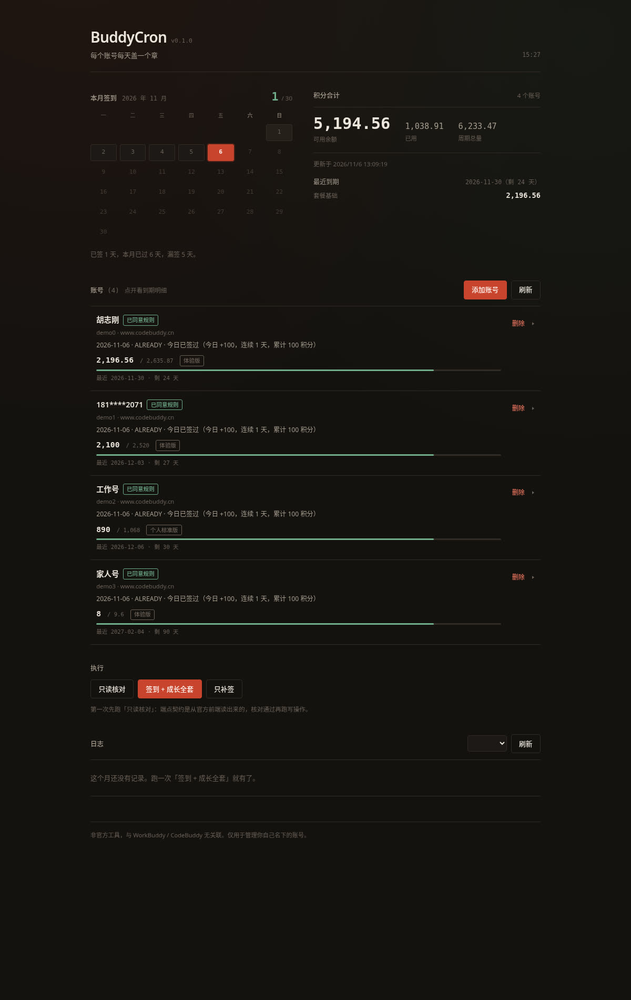
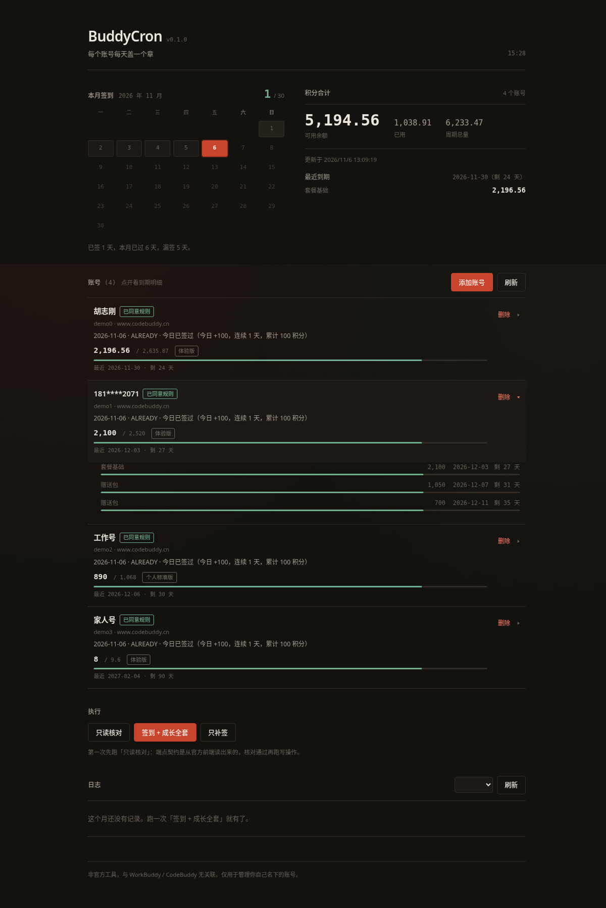
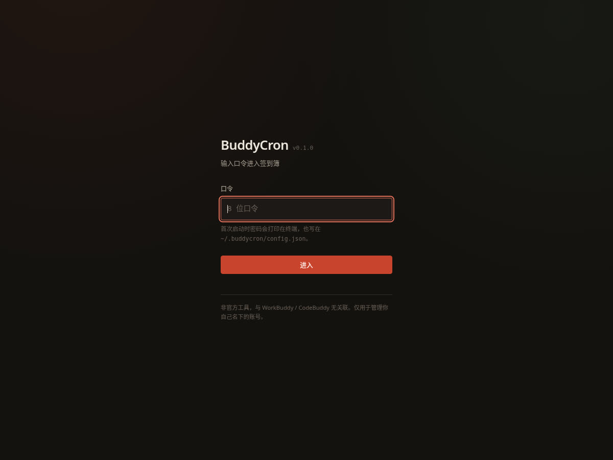

# BuddyCron

WorkBuddy 多账号签到与积分工具。CLI + 本地 Web 页，零第三方依赖。

## 快速开始

```bash
mkdir -p data
docker compose up -d
docker compose logs -f buddycron    # 首次会打印登录密码
```

浏览器打开 `http://127.0.0.1:8787/`，用打印出来的密码登录，点「添加账号」逐个授权。

不用 Docker 也可以：

```bash
python3 cli.py web      # 起 Web 页
python3 cli.py run      # 手动跑一轮
python3 cli.py status   # 看账号与最近结果
```

## 必填配置

只有三项，其余都有默认值。

| 场景 | 变量 | 不填的后果 |
|---|---|---|
| **公网访问**（必填） | `BUDDYCRON_HOSTS` | 所有请求返回 403——反向代理会改写 Host，白名单里没有你的域名 |
| **公网访问**（必填） | `BUDDYCRON_REQUIRE_HTTPS=1` | 服务拒绝启动（代码里的硬拦截，防止明文暴露口令） |
| Docker 首次部署（建议） | `BUDDYCRON_PASSWORD` | 能用，但要去 `docker compose logs` 里翻随机口令 |

如果 `./data` 的属主不是 UID 1000，还要加 `BUDDYCRON_UID=$(id -u) BUDDYCRON_GID=$(id -g)`，
否则会报 `PermissionError: /data/.config.json`。

## 界面



「签到簿」风格。四个区块：

- **本月签到** —— 整月日历，朱红是已签，今天描边，未来极淡
- **积分合计** —— 所有账号汇总 + 最近到期提醒
- **账号** —— 每行一个账号（签到状态、积分余额、到期提示）
- **日志** —— 按月份切换，每条可展开看每段细节

点开账号看包级到期明细：



**运行侧不需要 Node** —— `web/dist/` 里是编译好的产物。

## 登录



单口令，不需要用户名。

**推荐**：在环境变量里写死，省得翻日志：

```yaml
environment:
  BUDDYCRON_PASSWORD: "你的密码"
```

改了环境变量就等于改密码（下次启动生效）。

**不设时**：首次启动生成 8 位随机口令打印到终端。明文会留在 `config.json` 里直到你成功登录一次。

```bash
python3 cli.py passwd --show    # 查看当前口令
python3 cli.py passwd           # 随机重设
python3 cli.py passwd 我的密码    # 指定
```

会话是 HMAC 签名的 HttpOnly cookie，有效期 7 天。连续 5 次失败锁 5 分钟。
改密码会让所有旧会话失效。

> 环境变量模式下 `passwd` 会直接拒绝——它产出的新口令下次启动就被覆盖了，
> 让你以为改成功了。要改就改环境变量。

## 定时

| 时刻 | 动作 |
|---|---|
| 09:00（随机延迟 0~60 分） | 签到 + 成长全套 + 礼包 + 积分 |
| 09:00 / 13:00 / 17:00 / 21:00 | 补签兜底 + 旅行 |

签到没有「必须几点」的限制，过了 0 点就算新的一天。9 点后跑，醒来就能看到结果。
关机错过后开机会自动补跑。

**两套部署只启用一套**：Docker 容器里有一套调度，systemd 里也有一套。同时开会抢锁。

容器里可调：

```yaml
environment:
  BUDDYCRON_DAILY_HOUR: "9"
  BUDDYCRON_DAILY_MINUTE: "0"
  BUDDYCRON_POLL_HOURS: "4"
  BUDDYCRON_DISABLE_SCHEDULER: "1"   # 只跑 Web，不要定时
```

### 时间预算

账号串行跑，每账号切一份配额。默认 **900 秒总量 / 120 秒每账号 = 7 个账号**。

超过 7 个，后面的会被跳过并标注「时间预算耗尽」。改 `core/runner.py` 的
`DAILY_BUDGET` 时要同步改 `deploy/*.service` 的 `TimeoutStartSec`（必须更大，
否则进程被 systemd 杀掉而结果还没落盘）。

## 环境变量

除了 `BUDDYCRON_UID` / `BUDDYCRON_GID`，都由程序自己读取；那两个是 Docker Compose
的变量替换，只在 `docker-compose.yml` 里生效。

### 数据与口令

| 变量 | 默认 | 作用 |
|---|---|---|
| `BUDDYCRON_HOME` | `~/.buddycron`（容器里 `/data`） | 数据目录：账号库、配置、日志、锁 |
| `BUDDYCRON_PASSWORD` | 空（随机生成） | 登录口令。设了就用它，改了等于改密码 |

### Web 服务

| 变量 | 默认 | 作用 |
|---|---|---|
| `BUDDYCRON_REQUIRE_HTTPS` | 关 | 设 `1` 拒绝非 HTTPS，cookie 加 `Secure`。**绑非回环地址时必填** |
| `BUDDYCRON_HOSTS` | 空 | 允许的 Host，逗号分隔。**公网部署必填**，否则全部 403 |
| `BUDDYCRON_TRUST_PROXY` | 关 | 设 `1` 按 `X-Forwarded-For` 计数失败次数。不设的话所有访客算同一个人，别人试错会把你一起锁 |
| `BUDDYCRON_IN_CONTAINER` | 关 | 设 `1` 允许绑 `0.0.0.0` 而不要求 HTTPS。容器内绑 `0.0.0.0` 是正常的，暴露面由 `ports` 控制 |

### 定时（仅容器入口脚本读取）

| 变量 | 默认 | 作用 |
|---|---|---|
| `BUDDYCRON_DAILY_HOUR` | `9` | 每日签到的小时 |
| `BUDDYCRON_DAILY_MINUTE` | `0` | 每日签到的分钟 |
| `BUDDYCRON_POLL_HOURS` | `4` | 补签轮次间隔（小时） |
| `BUDDYCRON_DISABLE_SCHEDULER` | 关 | 设 `1` 只跑 Web |

> 这四个只在 `deploy/entrypoint.sh`（容器入口）里生效。用 systemd 时改
> `deploy/*.timer` 的 `OnCalendar`，那边没有对应的环境变量。

### Docker Compose 专用

| 变量 | 默认 | 作用 |
|---|---|---|
| `BUDDYCRON_UID` | `1000` | 容器运行用户。必须和 `./data` 属主一致 |
| `BUDDYCRON_GID` | `1000` | 同上，组 ID |

### 只进镜像元数据

| 变量 | 默认 | 作用 |
|---|---|---|
| `BUDDYCRON_VERSION` | `dev` | **运行时不读取**。CI 通过 build-arg 写进镜像 label，`docker inspect` 能看到。程序显示的版本来自 `core/version.py` |

## 数据

```
~/.buddycron/
├── accounts.json     账号库（含明文 token，0600）
├── config.json       口令散列 + 会话密钥（0600）
├── state.json        最近一轮结果
├── logs/YYYY-MM.log  按日分的汇报
└── run.lock          跨进程锁
```

目录 0700、文件 0600，写入走「临时文件 + rename」。

## 日志

界面底部按月份查看。文件每行一个 JSON，可以直接 `jq`：

```bash
tail -1 ~/.buddycron/logs/2026-11.log | jq '.accounts[0].growth.sections'
```

轮询空跑不写（一天跑多次，全写会淹没真事件）。写前脱敏。保留 6 个月。

## 本地开发

```bash
python3 -m unittest discover -s tests    # 测试（纯逻辑，不联网）

npm install                              # 只有改界面时需要
python3 web/build.py                     # 编译 Tailwind → web/dist/
```

`web/dist/` 是提交进仓库的产物，改界面后必须重编并提交，CI 会对比检查。

### 发布

```bash
vim core/version.py              # 改版本号（只改这一处）
python3 web/build.py             # 改了界面就重编
git commit -am "chore: 升到 v0.2.0" && git push
git tag v0.2.0 && git push origin v0.2.0    # 这一步才触发发布
```

tag 与 `core/version.py` 不一致时 CI 直接失败。镜像推到
`ghcr.io/<owner>/buddycron`，标签 `0.2.0` / `0.2` / `latest`，amd64 + arm64。

## 公网部署

默认只绑回环。大多数情况用 SSH 隧道就够了：

```bash
ssh -L 8787:127.0.0.1:8787 you@server
```

要真开公网，Caddy 终止 TLS，BuddyCron 仍只监听 127.0.0.1。完整步骤见
**[deploy/PUBLIC.md](deploy/PUBLIC.md)**。

## 项目结构

```
core/      http / accounts / auth / checkin / growth / credits / extras
           runner / logs / doctor / version / paths
web/       server.py（Web 页）、build.py（界面构建）、src/、dist/
cli.py     命令行入口
deploy/    systemd units、容器入口、公网部署文档
```

## 能力边界

几个服务端决定的硬限制，不是实现缺陷：

- **任务类积分（一次性 1800）需要先在客户端里完成真实操作**。18 项任务都要求先完成
  `first_buddy`，而它的条件是「在客户端里真的产生一次对话」，服务端没有上报进度的
  接口。工具能做的是「接取 + 领奖」两端，中间那段得你自己做。
- **旅行每天只能派一次**，早领礼物不增加收益。
- **能量只能换虚拟宠物**，对积分零收益。

签到一项占稳态收益的 86%（每天 100 积分），是最值钱也最省事的。

### 成长中心的执行顺序

七段顺序固定，每一段的位置都有理由：

| # | 动作 | 为什么在这个位置 |
|---|---|---|
| 1 | 旅行：领已有礼物 | 先领，避免后面的操作覆盖记录 |
| 2 | 任务：接取 + 领已完成奖励 | 任务送的能量 / 抽奖机会，后面马上要用 |
| 3 | 补登：断登补一张卡 | 会改变连签天数，必须早于兑换 |
| 4 | 连登兑换：7 / 14 / 28 天三档 | 读最新的连签状态 |
| 5 | 抽奖：用兑换得到的次数 | 次数来自上一步 |
| 6 | Buddy 盲盒：用能量开桌宠 | 会覆盖旅行记录，必须在旅行明确 idle 时 |
| 7 | 最后派出 | 不覆盖在途礼物；也让「每天只跑一次」的用户有机会开盲盒 |

## 免责

非官方工具，与 WorkBuddy / CodeBuddy 无任何关联。接口从官方前端逆向所得，
腾讯改一版就可能失效。官方活动规则禁止「恶意注册多个账号」与「使用脚本篡改
任务完成数据」。仅用于管理你自己名下的账号，风险自担。
